<!-- Header -->
<p align="center">
  
</p>

<p align="center">
  
</p>

<p align="center">
  <a href="https://pratuldeshpande.com"></a>
  <a href="https://www.linkedin.com/in/pratuldeshpande"></a>
  <a href="https://pypi.org/project/qiskit-waveform-sim/"></a>
</p>


### `> whoami`

I build software that sits close to hardware: Softwares for application layer, firmware for Hardware layer and tools for the control layer of quantum computers.

<p align="center"></p>

### `> ls ./projects`

<table>
<tr>
<td width="33%" valign="top">

#### ⚛️ [qiskit-waveform-sim](https://github.com/PratulDeshpande/qiskit-waveform-sim)

Qiskit 2.0 removed `qiskit.pulse`. This brings pulse-level visibility back: it rebuilds DRAG and GaussianSquare envelopes from a scheduled circuit and plots an interactive pulse sheet and I/Q oscilloscope.


</td>
<td width="33%" valign="top">

#### 🔐 [PQCMicro](https://github.com/PratulDeshpande/PQCMicro)

NIST post-quantum cryptography on microcontrollers. ML-KEM-512 (FIPS 203) and ML-DSA-44 (FIPS 204), ported from PQClean, with FreeRTOS tasks, NVS key storage, and key chunking for LoRa and BLE.


</td>
<td width="33%" valign="top">

#### 🏭 [IonFiltra](https://github.com/PratulDeshpande/IonFiltra)

Industrial IoT for pulse-jet bag filters. STM32 nodes on Modbus RTU and LoRa, an ESP32 GSM gateway, a live React dashboard, and Gemini-powered failure analytics with a RAG assistant.

<a href="https://ionfiltra.pratuldeshpande.com"></a>


</td>
</tr>
</table>

<p align="center"></p>

### `> cat shipped.log`

```diff
+ qiskit-waveform-sim   published on PyPI, listed in the Qiskit Ecosystem
+ PQCMicro              installable via Arduino Library Manager, PlatformIO, ESP-IDF
+ IonFiltra             end-to-end: firmware → gateway → cloud → AI, live demo online
```

<p align="center"></p>

### `> toolbox`

<p align="center">
  <br>
  
</p>

<p align="center">
  
  
  
  
  
  
  
  
</p>

<p align="center"></p>

<p align="center"><sub>Open to collaborations on quantum software, embedded security, and IIoT · <a href="https://pratuldeshpande.com">pratuldeshpande.com</a></sub></p>

